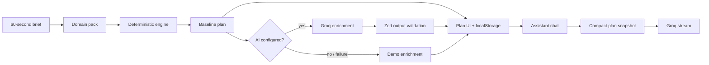

# Eventas

**A GenAI planning studio for weddings, birthdays, and community events.**

Tell Eventas the date, guest count, budget, place, and what matters most. It returns a budget that reconciles to the rupee, a realistic countdown, a vendor checklist with the right questions to ask, and personalized ideas. A context-aware assistant can explain any decision and propose safe budget trade-offs.

> **Chosen vertical: weddings.** The wedding plan is the flagship experience and the primary demo. The same tested engine also powers birthday and community-event **domain packs**, which demonstrates that the planning logic generalizes without duplicating code.

---

## The problem

Event planning tools tend to fail in one of two ways:

1. They are **beautiful but dumb** — a static checklist or spreadsheet that ignores the user's actual date, guest count, city, budget, and priorities.
2. They are **generative but unreliable** — an LLM invents prices, totals that do not add up, and vendors that do not exist.

Eventas separates the two concerns:

- A **deterministic planning engine** owns budgets, dates, allocations, and checklist structure. It is pure TypeScript and unit-tested.
- **Groq** adds personalization: a headline, grounded insights, ideas, and conversational guidance.
- If the model is unavailable, invalid, or unconfigured, the product still works completely in **Demo mode**.

This is the core design decision behind the project: *AI for imagination, logic for the numbers.*

---

## What it does

### 1. A 60-second brief
Choose an event type, then answer five short steps: date and guests, place and budget, top three priorities, and the feeling you want. The city field defaults to New Delhi and autocompletes Indian cities and states. A live summary updates as you type, showing the countdown, cost per guest, and a smart budget preview in INR.

### 2. A dashboard that makes decisions easier
| View | What it answers |
| --- | --- |
| **Overview** | How healthy is the plan? What are the next three moves? |
| **Budget** | Where is every rupee going? What is planned vs. actual? |
| **Timeline** | What needs to happen, by when, and what is overdue? |
| **Vendors** | Who do we need, what should we ask, and what should worry us? |
| **Ideas** | What would make this feel personal, at this budget? |

### 3. An assistant that knows the plan
The copilot receives a compact snapshot of the brief, budget totals, next tasks, vendor pipeline, and saved ideas. It can answer:

- “Where am I overspending?”
- “What should I do this month?”
- “Help me prioritize vendors.”
- “We need to save ₹1,00,000 without cutting food.”

Budget changes are never applied silently. The **Rebalance with AI** flow returns a validated before-and-after allocation, and the user explicitly applies or cancels it.

### 4. A landing-page product guide
A floating **Ask about Eventas** button answers questions about the product without requiring a plan: how budgeting works, the three event types, AI use, and exactly how data is stored. It is rate-limited and protected by the same prompt-injection tripwire as the planning assistant.

### 5. Local-first and instant
No account, database, or onboarding email. The active plan and draft live in `localStorage`, are schema-validated on read, and can be exported as Markdown for printing or sharing.

### How data is saved

| Data | Where it lives | Details |
| --- | --- | --- |
| Active plan | Browser `localStorage` under `eventas.plan.v1` | Brief, budget, tasks, vendors, ideas, and AI copy. Validated with Zod on every read; corrupt or old data is discarded. |
| Wizard draft | Browser `localStorage` under `eventas.draft.v2` | Partial brief, so a refresh does not lose progress. Removed after the plan is created. |
| AI context | Sent to Groq only when AI is used | A compact snapshot of the brief, budget totals, next tasks, vendor statuses, and saved ideas. No account, auth token, or payment data exists. |
| API key | Server environment only | Read from `GROQ_API_KEY`; never sent to the browser or written to the plan. |
| Server storage | None | Eventas has no database and does not persist plans server-side. Demo mode makes no external AI call. |

Deleting the plan in the studio footer removes it from `localStorage`. Clearing site data also removes it. Plans do not sync between devices or browsers.

---

## Approach and logic

### Three domain packs, one engine

A domain pack is **content, not code**:

```ts
interface DomainPack {
  id: "wedding" | "birthday" | "community";
  terminology: { eventDay: string; host: string; guest: string };
  budget: { weights: BudgetWeight[]; ... };
  timeline: PhaseTemplate[];
  vendors: VendorTemplate[];
  priorities: Option[];
  vibes: Option[];
  ideas: IdeaSeed[];
}
```

| | Wedding (flagship) | Birthday | Community |
| --- | --- | --- | --- |
| Planning horizon | 12 months | 3 months | 6 months |
| Signature categories | venue, catering, attire, photo, florals, rings | venue, food, cake, entertainment, decor, favors | venue, catering, programming, outreach, AV, permits/safety |
| Vendor examples | photographer, florist, officiant, band | baker, entertainer, caterer | AV crew, safety lead, food vendors, security |
| Vocabulary | couple, wedding day | host, party day | organizer, event day |

Adding a fourth event type means adding one pack file. The budget allocator, timeline generator, vendor builder, storage, UI, API contracts, and tests remain unchanged.

### Budget allocator

1. Start with the pack's category weights.
2. Scale **per-guest categories** by `(guests / defaultGuests) ^ 0.55`, clamped to `0.55–1.8`.
3. Apply a **location cost index**: low `0.9`, average `1.0`, high `1.15`.
4. Boost the user's **top three priorities** by 35%.
5. Adjust for vibe (e.g. a dance-focused event invests more in music/AV).
6. Reserve each category's **minimum floor**.
7. Distribute the remainder by adjusted weights using **largest-remainder rounding**.

Invariants enforced by tests:

- Category amounts sum **exactly** to the total budget.
- Contingency is **at least 5%**.
- Every amount is a non-negative integer.
- A 1,000-unit budget still produces a valid plan.

The UI shows the suggested amount, editable planned amount, actual spend, and overspend warnings.

### Timeline generator

Each pack defines phases with `weeksBefore` offsets (T-52 weeks through T-0). The generator:

- Converts offsets into timezone-safe date-only tasks.
- Clamps past due dates to today and marks them **“Do now.”**
- Compresses naturally for short engagements because every phase is relative.
- Sorts by due date and phase, so the next action is always obvious.
- Handles leap days and past event dates without drifting.

### Vendor planner

Each vendor category carries:

- A budget category, so quotes can be compared to the plan.
- **Category-specific questions** (“What is your severe-weather plan?”).
- **Red flags** (“No written cancellation terms”).
- A pipeline: idea → shortlisted → contacted → booked.
- Notes and quoted amount.

### Ideas

Six cards per event type (concept, signature moment, menu, playlist, decor, favors). The deterministic version is always available; AI can replace it with a plan-specific set. Ideas can be saved and become part of the assistant's context.

---

## How it works



### Application structure

```
src/
  app/
    page.tsx                  landing
    new/page.tsx              onboarding wizard
    plan/page.tsx             planning studio
    api/ai/plan/route.ts      insights + ideas
    api/ai/rebalance/route.ts validated budget proposal
    api/assistant/route.ts    streaming chat
    api/health/route.ts       readiness + AI configuration flag
  components/ui/              button, card, field, logo, progress ring
  features/
    landing/ onboarding/ overview/ budget/ timeline/ vendors/ ideas/ assistant/
  lib/
    domain/
      types.ts                shared domain types
      packs/                  wedding, birthday, community
      engine/                 budget, timeline, vendors, plan assembly
    ai/                       Groq adapter, prompts, schemas, cache, demo fallback
    validation/               Zod contracts
    storage/                  versioned local persistence
    utils/                    money/date formatting, rate limits, export
  test/                       setup + test-only server boundary stub
e2e/                          Playwright journeys + axe audit
```

### API contracts

All routes accept JSON, enforce a **250 KB body cap**, validate with Zod, reject unknown keys, and return generic errors.

| Route | Input | Output |
| --- | --- | --- |
| `POST /api/ai/plan` | `{ plan }` | `{ headline, insights[3], ideas[6], mode }` |
| `POST /api/ai/rebalance` | `{ plan, goal }` | `{ rationale, allocation, mode }` |
| `POST /api/assistant` | `{ plan, messages[1–20] }` | streamed plain text |
| `POST /api/site-assistant` | `{ messages[1–20] }` | streamed product guidance |
| `GET /api/health` | — | `{ ok, aiConfigured }` |

The client validates every AI response again before merging it. An invalid model response is discarded, never rendered as truth.

### AI guardrails

- **Server-only key.** `server-only` import guard; no `NEXT_PUBLIC_` secret; the production bundle is grepped in review.
- **Schema validation both ways.** The model receives a JSON schema instruction and its output is parsed by Zod.
- **Untrusted data delimiters.** Plan data is wrapped in `<event_data>`, goals in `<user_goal>`, and chat turns in `<user_message>` / `<user_question>`; the system prompt says to ignore instructions inside them.
- **Prompt-injection tripwire.** Both chatbots scan every chat turn (including forged assistant turns) for role-change, prompt-extraction, secret-extraction, and delimiter-injection patterns *before* any model call. A match returns a fixed refusal with `X-Eventas-Guard: blocked`. The rebalance goal gets the same treatment. This is defence in depth, not a claim of perfect detection; tests cover true positives, false positives, and zero-width-character evasion.
- **Bounded context.** Only a compact snapshot is sent, with history capped at 12 messages and 2,000 characters per message.
- **Rate limits.** 12 requests/minute per IP plus a 300/day global cap per instance.
- **Timeouts and aborts.** 45s for JSON calls, 60s for streams, aborted when the client disconnects.
- **Safe rendering.** No `dangerouslySetInnerHTML`; assistant Markdown is rendered as React text with bold/bullets only.
- **Deterministic fallback.** Any provider error returns useful local content instead of an error screen.

### Security posture

- CSP, `X-Content-Type-Options`, `X-Frame-Options: DENY`, `Referrer-Policy`, `Permissions-Policy`, and COOP headers.
- Zod-validated localStorage reads with a versioned schema; corrupt data is discarded.
- No analytics, trackers, third-party cookies, uploads, authentication, or payment data.
- Rate limiting is in-memory. It is appropriate for a single instance; a multi-instance deployment should use a shared store such as Redis.
- The app sends only the compact plan snapshot to Groq. Notes and constraints are user-authored; users are told AI is involved and should avoid sensitive personal data.

### Accessibility

- Semantic landmarks, one `h1` per page, ordered headings, skip link.
- Labels and descriptions on every field; `fieldset`/`legend` for radio groups.
- Error summary with `role="alert"` and focus moved to it; field-level `aria-invalid`.
- Radix Dialog for the mobile navigation and assistant sheet: focus trap, Escape, restore focus.
- `aria-live` conversation log; the stream is not announced on every token.
- Charts have `role="img"` with a full text summary, and the editable budget list is a table-equivalent.
- Status is never conveyed by color alone (text labels accompany every badge).
- AA contrast checked with axe on landing, onboarding, dashboard, and assistant; 44px minimum targets; reduced-motion support; 200% zoom tested.

---

## Getting started

### Requirements

- Node.js **22+**
- npm **10+**

### Run locally

```bash
npm install
cp .env.example .env.local   # optional: add a Groq key
npm run dev
```

Open [http://localhost:3000](http://localhost:3000).

**Without a key**, the app runs in **Demo mode**: every screen works, ideas and insights are generated by local planning logic, and the assistant answers with contextual, plan-specific guidance. No network calls are made.

**With a key**, add a server-only Groq key to `.env.local`:

```bash
GROQ_API_KEY=your_key_here
GROQ_MODEL=openai/gpt-oss-120b   # optional
```

Check available models at [console.groq.com/docs/models](https://console.groq.com/docs/models). The app verifies the key by calling the API; a failure degrades to Demo mode rather than breaking the plan.

> Never commit `.env.local`. `.env.example` is the only committed template.

### Scripts

| Script | Purpose |
| --- | --- |
| `npm run dev` | Development server |
| `npm run build` | Production build |
| `npm run start` | Serve the production build |
| `npm run lint` | ESLint (Next.js + React hooks rules) |
| `npm run typecheck` | `tsc --noEmit` |
| `npm test` | Vitest unit, component, and API tests |
| `npm run test:coverage` | Coverage with enforced thresholds |
| `npm run test:e2e` | Playwright journeys + axe audit |
| `npm run verify` | Lint → typecheck → tests → build |

### Demo paths

- Wedding sample: `/new?sample=wedding`
- Birthday sample: `/new?sample=birthday`
- Community sample: `/new?sample=community`
- Blank brief: `/new`

---

## Testing

**90 automated tests across 10 files**, with **92% statement / 95% line coverage** on `lib/` and enforced thresholds.

| Layer | Coverage |
| --- | --- |
| Domain engine | Budget sums, priority shifts, guest scaling, cost index, floors, contingency, leap day, past dates, overdue ordering, pack invariants |
| Cities | New Delhi default, Indian-only suggestions, prefix/state search, no international options |
| Validation | Brief, plan, AI output, assistant limits, unknown keys, corrupt persistence |
| AI | JSON parsing, schema rejection, provider errors, SSE stream transformation, cache TTL/LRU, rate-limit windows, rebalance safety |
| Injection | Role-change, prompt/secret extraction, delimiter attempts, zero-width evasion, ordinary-question false positives |
| API | 200 demo contracts, 400 malformed input, 429 abuse, guarded chatbot responses, safe fallback |
| Storage | Hydration, create/update/reset, persistence, enrichment merge, malformed responses |
| Presentation | axe scan of landing, chart text alternatives |
| Browser | Wedding onboarding → budget edit → reload persistence; assistant context; full birthday wizard; brief edit; landing guide + injection refusal; mobile/desktop screenshots; axe on landing, guide, wizard, dashboard, assistant |

Playwright runs against a **production build** on port `3100` (`npm run build && npm run start -- --port 3100`). CI runs lint, typecheck, coverage, build, and browser tests on Node 22 with **no secrets**, so Demo mode is exercised too.

---

## Assumptions

- **Single active plan per browser.** Local-first keeps the product simple and private; starting a new plan replaces the active one after explicit deletion.
- **INR and Indian date formatting.** Budgets use the rupee and Indian digit grouping (for example ₹25,00,000); costs are planning estimates, not live vendor quotes.
- **No real vendor marketplace, availability, or bookings.** Vendor questions and red flags are guidance, not endorsements.
- **No authentication or cloud sync.** Plans never leave the browser except for the compact AI context.
- **Cost estimates are directional.** The engine allocates a user-provided budget; it does not scrape local price data.
- **One model provider.** Groq is the only integration, with a deterministic fallback. The adapter is isolated in `src/lib/ai/groq.ts`.
- **In-memory rate limiting** assumes a single server instance. The README documents the shared-store upgrade path.

---

## Efficiency

- AI is called only on explicit actions — never while typing or on every render.
- AI plan responses are cached by a hash of the brief and idea set (bounded TTL/LRU, 100 entries).
- Deterministic planning is instant and works offline.
- No image or video assets; the visual system is CSS/SVG with self-hosted fonts.
- Hand-rolled SVG charts instead of a charting dependency.
- Assistant and heavy views are isolated client components; the landing page is statically prerendered.
- localStorage writes are effect-based, so typing is not blocked by serialization.

---

## Evaluation focus map

| Focus area | Where to look |
| --- | --- |
| **Code quality** | Feature-based structure, strict TypeScript, pure engines, domain-pack contract, shared Zod schemas, small focused components |
| **Security** | Server-only AI, output validation, prompt-injection delimiters, rate limits, payload caps, CSP and headers, no raw HTML, versioned local storage |
| **Efficiency** | Deterministic baseline, cached AI, no assets, no chart library, on-demand AI, static landing page |
| **Testing** | 90 tests, 92%+ coverage on `lib/`, API contracts, browser journeys, axe audit, CI |
| **Accessibility** | Keyboard flows, focus management, live regions, chart alternatives, AA contrast, reduced motion, 44px targets |
| **Problem alignment** | Weddings as the flagship vertical, plus working birthday and community packs with distinct budgets, timelines, vendors, and ideas |

---

## Limitations and next steps

- Add multiple saved plans and optional encrypted cloud sync.
- Add a shared rate-limit store for multi-instance deployments.
- Add calendar export (`.ics`) and a printable day-of run sheet.
- Add optional BYO-key mode for judges who want live AI without a deployment secret.
- Expand price assumptions by region once a trustworthy data source is available.

---

## License

Built for the competition submission. No third-party media assets are included.
