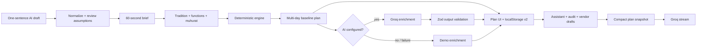

# Eventas

[](https://nextjs.org)
[](https://react.dev)
[](https://www.typescriptlang.org)
[](https://tailwindcss.com)
[](https://nodejs.org)
[](#testing)
[](#testing)
[](#testing)
[](#accessibility)
[](#how-data-is-saved)
[](#license)

**A GenAI planning studio for weddings, birthdays, and community events.**

Tell Eventas the date, guest count, budget, place, and what matters most. For Indian weddings it also captures the tradition, the functions, and an optional muhurat. It returns a budget that reconciles to the rupee, a realistic multi-day countdown, a vendor checklist with the right questions to ask, and personalized ideas. A context-aware assistant can explain any decision, audit what is missing, draft vendor messages, and propose safe budget trade-offs.

> **Chosen vertical: weddings.** The wedding plan is the flagship experience and the primary demo. The same tested engine also powers birthday and community-event **domain packs**, which demonstrates that the planning logic generalizes without duplicating code.

---

## The problem

Event planning tools tend to fail in one of two ways:

1. They are **beautiful but dumb** — a static checklist or spreadsheet that ignores the user's actual date, guest count, city, budget, and priorities.
2. They are **generative but unreliable** — an LLM invents prices, totals that do not add up, and vendors that do not exist.

Eventas separates the two concerns:

- A **deterministic planning engine** owns budgets, dates, allocations, and checklist structure. It is pure TypeScript and unit-tested.
- **Groq** adds personalization: a headline, grounded insights, ideas, and conversational guidance.
- If the model is unavailable, invalid, or unconfigured, the product still works completely in **Demo mode**.

This is the core design decision behind the project: *AI for imagination, logic for the numbers.*

---

## What it does

### 1. A 60-second brief — or one sentence to AI
Choose an event type, then answer five short steps: date and guests, place and budget, top three priorities, and the feeling you want. For weddings, the brief also captures a **tradition/region** (North Indian Hindu, Punjabi/Sikh, Gujarati, Rajasthani, South Indian, Bengali, Marathi, Muslim, Christian, interfaith), the **functions** you are hosting, and an optional **muhurat** window. The city field defaults to New Delhi, autocompletes Indian cities and states, and sets a starting cost level from the city tier.

Prefer to describe it once? The **Build with AI** panel turns a sentence such as “Punjabi wedding in Chandigarh, 350 guests, ₹45 lakh, November 2026, with mehndi, sangeet and reception” into a structured draft with functions, assumptions, and follow-up questions. You review every assumption before the deterministic engine builds the plan. It never invents a muhurat: only curated dates from the supplied table are accepted.

### 2. A dashboard that makes decisions easier
| View | What it answers |
| --- | --- |
| **Overview** | How healthy is the plan? What are the next three moves? What is still open? |
| **Functions** | Which events are we hosting, when, where, for how many guests, and at what target budget? |
| **Budget** | Where is every rupee going? What is planned vs. actual? |
| **Timeline** | What needs to happen, by when, for which function, and what is overdue? |
| **Vendors** | Who do we need, what should we ask, and what should worry us? |
| **Ideas** | What would make this feel personal, at this budget? |

### 3. An assistant that knows the plan
The copilot receives a compact snapshot of the brief, tradition, functions, muhurat, budget totals, next tasks, vendor pipeline, saved ideas, and a deterministic “what is still open” audit. It can answer:

- “Where am I overspending?”
- “What should I do this month?”
- “What am I forgetting?”
- “Build a day-of run sheet.”
- “Help me prioritize vendors.”
- “We need to save ₹1,00,000 without cutting food.”

Budget changes are never applied silently. The **Rebalance with AI** flow returns a validated before-and-after allocation, and the user explicitly applies or cancels it. The Vendors view can also **draft a WhatsApp-ready enquiry** with the plan’s functions, guest count, and category-specific questions; the draft is copyable and reviewable before sending.

### 4. A landing-page product guide
A floating **Ask about Eventas** button answers questions about the product without requiring a plan: how budgeting works, the three event types, AI use, and exactly how data is stored. It is rate-limited and protected by the same prompt-injection tripwire as the planning assistant.

### 5. Local-first and instant
No account, database, or onboarding email. The active plan and draft live in `localStorage`, are schema-validated on read, and can be exported as a print-ready PDF with functions, muhurat, budget, timeline, vendor notes, and saved ideas.

### How data is saved

| Data | Where it lives | Details |
| --- | --- | --- |
| Active plan | Browser `localStorage` under `eventas.plan.v2` | Brief, tradition, functions, muhurat, budget, tasks, vendors, ideas, and AI copy. Validated with Zod on every read. A valid v1 plan is migrated in place; corrupt data is discarded. |
| Wizard draft | Browser `localStorage` under `eventas.draft.v2` | Partial brief, so a refresh does not lose progress. Removed after the plan is created. |
| AI context | Sent to Groq only when AI is used | A compact snapshot of the brief, tradition, functions, muhurat, budget totals, next tasks, vendor statuses, saved ideas, and deterministic audit gaps. No account, auth token, guest list, or payment data exists. |
| API key | Server environment only | Read from `GROQ_API_KEY`; never sent to the browser or written to the plan. |
| Server storage | None | Eventas has no database and does not persist plans server-side. Demo mode makes no external AI call. |

Deleting the plan in the studio footer removes it from `localStorage`. Clearing site data also removes it. Plans do not sync between devices or browsers.

---

## Approach and logic

### Three domain packs, one engine

A domain pack is **content, not code**:

```ts
interface DomainPack {
  id: "wedding" | "birthday" | "community";
  terminology: { eventDay: string; host: string; guest: string };
  budget: { weights: BudgetWeight[]; ... };
  timeline: PhaseTemplate[];
  vendors: VendorTemplate[];
  priorities: Option[];
  vibes: Option[];
  ideas: IdeaSeed[];
}
```

| | Wedding (flagship) | Birthday | Community |
| --- | --- | --- | --- |
| Planning horizon | 12 months | 3 months | 6 months |
| Signature categories | venue, catering, decor, photo, attire, jewellery, mehndi/makeup, music/dhol, ceremony, invitations, gifts, transport, hotel, permits, planner, contingency | venue, food, cake, entertainment, decor, favors | venue, catering, programming, outreach, AV, permits/safety |
| Vendor examples | pandit/officiant, caterer, decorator, photographer, mehndi artist, dhol/DJ, planner, hotel, jeweller, security | baker, entertainer, caterer | AV crew, safety lead, food vendors, security |
| Vocabulary | couple, wedding day, muhurat, functions | host, party day | organizer, event day |

The wedding pack is deliberately **multi-day and regional**:

- A `TraditionProfile` content layer supplies typical functions, ritual lead, food defaults, and family notes for North Indian Hindu, Punjabi/Sikh, Gujarati, Rajasthani, South Indian, Bengali, Marathi, Muslim, Christian, and interfaith weddings.
- `resolveFunctions` turns the brief into dated functions and splits the total budget into **exact per-function targets** (largest-remainder rounding).
- `muhurat.ts` is a small, source-labelled curated table. The assistant may suggest only dates in that table and always asks the family to confirm with their pandit.
- The Timeline view anchors function-specific tasks to that function’s date, so mehndi, sangeet, baraat, and reception deadlines do not all land on the ceremony day.

Adding a fourth event type means adding one pack file. The budget allocator, timeline generator, vendor builder, storage, UI, API contracts, and tests remain unchanged.

### Budget allocator

1. Start with the pack's category weights.
2. Apply an explicit **guest-scaling mode** per category: `linear` for per-plate costs (catering, invitations, gifts, transport, hotel), `sublinear` for venue and permits, and `fixed` for decor, photo, music, and ceremony. This is calibrated for 300–500 guest Indian weddings, where per-plate costs should not grow at the old `^0.55` rate.
3. Apply a **location cost index**: low `0.85`, average `1.0`, high `1.2` to cost-sensitive categories.
4. Boost the user's **top three priorities** by 35%.
5. Adjust for vibe (e.g. a celebration invests more in music; a royal destination invests more in decor, venue, and hotel).
6. Reserve each category's **minimum floor**.
7. Distribute the remainder by adjusted weights using **largest-remainder rounding**.
8. Split the total into **exact per-function targets** (ceremony 1.0, reception 0.85, sangeet 0.5, mehndi 0.3, and so on) for the Functions view and budget strip.

Invariants enforced by tests:

- Category amounts sum **exactly** to the total budget.
- Per-function targets sum **exactly** to the total budget.
- Contingency is **at least 5%**.
- Every amount is a non-negative integer.
- A 1,000-unit budget still produces a valid plan.
- Larger guest counts raise catering more than fixed decor.

The UI shows the suggested amount, editable planned amount, actual spend, overspend warnings, and an **18% GST/service-charge reminder** on vendor quotes. GST is not a separate budget line because it is usually embedded in venue and catering quotes; the app asks users to request all-inclusive numbers instead of double-counting.

### Timeline generator

Each pack defines phases with `weeksBefore` offsets (T-52 weeks through T-0). The generator:

- Converts offsets into timezone-safe date-only tasks.
- **Anchors function-specific tasks to their own function date**, so mehndi, sangeet, and baraat deadlines do not all land on the ceremony day.
- Clamps past due dates to today and marks them **“Do now.”**
- Compresses naturally for short engagements because every phase is relative.
- Sorts by due date and phase, so the next action is always obvious.
- Handles leap days and past event dates without drifting.
- Shows a per-function filter and badge in the Timeline view.

The muhurat is a separate, explicit fixed window. The ceremony task and the day-of plan build around it; the app never derives a muhurat from a date.

### Vendor planner

Each of the 16 Indian wedding vendor categories carries:

- A budget category, so quotes can be compared to the plan.
- **Category-specific questions** (“Is the baraat allowed on the property?”, “What is the per-plate rate for Jain/satvik food, including GST?”, “Is a havan or open fire permitted indoors?”).
- **Red flags** (“GST and service charge excluded from the quote”, “Outside caterer prohibited after deposit”, “No fire NOC”).
- A pipeline: idea → shortlisted → contacted → booked.
- Notes, quoted amount, and a budget-fit warning.
- A **Draft enquiry** action that writes a plan-aware WhatsApp message using the category’s questions, with a copy button.

### Ideas

Six cards per event type (concept, signature moment, menu, playlist, decor, favors). The Indian wedding set is deliberately practical: a weekend rather than a week, a grandparents’ blessing, one regional menu per function, a family-story sangeet, reusing mandap florals at dinner, and a useful welcome hamper. The deterministic version is always available; AI can replace it with a plan-specific set. Ideas can be saved and become part of the assistant's context.

---

## How it works



The AI path never computes the budget, timeline, or muhurat. It extracts a brief, explains, drafts, and proposes; the deterministic engine remains the source of every rupee and date.

### Application structure

```
src/
  app/
    page.tsx                  landing
    new/page.tsx              onboarding wizard
    plan/page.tsx             planning studio
    api/ai/plan/route.ts      insights + ideas
    api/ai/rebalance/route.ts validated budget proposal
    api/ai/wedding-draft/route.ts  natural-language wedding draft
    api/ai/draft-message/route.ts  vendor enquiry draft
    api/assistant/route.ts    streaming chat
    api/health/route.ts       readiness + AI configuration flag
  components/ui/              button, card, field, logo, progress ring
  features/
    landing/ onboarding/ overview/ functions/ budget/ timeline/ vendors/ ideas/ assistant/
  lib/
    domain/
      types.ts                shared domain types (tradition, functions, muhurat)
      traditions.ts           per-tradition functions, ritual lead, food defaults
      functions.ts            multi-day function resolution + exact budget split
      muhurat.ts              curated, source-labelled muhurat table
      city-tiers.ts           metro / tier-2 / tier-3 / destination cost defaults
      constraints.ts          shared guest-need options + AI normalization
      packs/                  Indian wedding, birthday, community
      engine/                 budget, timeline, vendors, plan assembly, audit
    ai/                       Groq adapter, prompts, schemas, cache, demo fallback
    validation/               Zod contracts
    storage/                  versioned local persistence + v1→v2 migration
    utils/                    money/date formatting, rate limits, export
  test/                       setup + test-only server boundary stub
e2e/                          Playwright journeys + axe audit
```

### API contracts

All routes accept JSON, enforce a **250 KB body cap**, validate with Zod, reject unknown keys, and return generic errors.

| Route | Input | Output |
| --- | --- | --- |
| `POST /api/ai/plan` | `{ plan }` | `{ headline, insights[3], ideas[6], mode }` |
| `POST /api/ai/rebalance` | `{ plan, goal }` | `{ rationale, allocation, mode }` |
| `POST /api/ai/wedding-draft` | `{ message, current? }` | `{ brief, assumptions, questions, mode }` |
| `POST /api/ai/draft-message` | `{ plan, vendorId, intent? }` | `{ body, mode }` |
| `POST /api/assistant` | `{ plan, messages[1–20] }` | streamed plain text |
| `POST /api/site-assistant` | `{ messages[1–20] }` | streamed product guidance |
| `GET /api/health` | — | `{ ok, aiConfigured }` |

The client validates every AI response again before merging it. An invalid model response is discarded, never rendered as truth. The wedding-draft route returns a **complete, schema-valid Brief** after normalization; the client shows assumptions and questions before the deterministic engine builds anything.

### AI guardrails

- **Server-only key.** `server-only` import guard; no `NEXT_PUBLIC_` secret; the production bundle is grepped in review.
- **Schema validation both ways.** The model receives a JSON schema instruction and its output is parsed by Zod. Draft schemas tolerate missing/null fields, then normalize into a complete, bounded brief; unknown keys and invalid function kinds are rejected.
- **AI proposes, the engine computes.** The wedding builder extracts a brief and functions, but `buildPlan()` still owns every rupee, date, and checklist item. The model never generates the final budget table or timeline directly.
- **Curated muhurat only.** The assistant may suggest a date only from `muhurat.ts`, and only for traditions that use a muhurat. It always asks the family to confirm with their pandit. It does not invent GST, legal, or permit rules; those answers point to a CA, lawyer, or local authority.
- **Deterministic audit.** “What am I forgetting?” is computed by `auditPlan()` from budget, functions, vendors, deadlines, and tradition defaults. The model may phrase the gaps but cannot invent them.
- **Untrusted data delimiters.** Plan data is wrapped in `<event_data>`, goals in `<user_goal>`, and chat turns in `<user_message>` / `<user_question>`; the system prompt says to ignore instructions inside them.
- **Prompt-injection tripwire.** Both chatbots scan every chat turn (including forged assistant turns) for role-change, prompt-extraction, secret-extraction, and delimiter-injection patterns *before* any model call. A match returns a fixed refusal with `X-Eventas-Guard: blocked`. The rebalance goal, vendor-message intent, and wedding-draft message get the same treatment. This is defence in depth, not a claim of perfect detection; tests cover true positives, false positives, and zero-width-character evasion.
- **Bounded context.** Only a compact snapshot is sent, with history capped at 12 messages and 2,000 characters per message. Guest lists are not sent because they do not exist yet.
- **Rate limits.** 12 requests/minute per IP plus a 300/day global cap per instance.
- **Timeouts and aborts.** 45s for JSON calls, 60s for streams, aborted when the client disconnects.
- **Safe rendering.** No `dangerouslySetInnerHTML`; assistant Markdown is rendered as React text with bold/bullets only.
- **Deterministic fallback.** Any provider error returns useful local content (including a locally parsed wedding draft and vendor message) instead of an error screen.

### Security posture

- CSP, `X-Content-Type-Options`, `X-Frame-Options: DENY`, `Referrer-Policy`, `Permissions-Policy`, and COOP headers.
- Zod-validated localStorage reads with a versioned schema and a v1→v2 migration; corrupt data is discarded.
- No analytics, trackers, third-party cookies, uploads, authentication, or payment data.
- Rate limiting is in-memory. It is appropriate for a single instance; a multi-instance deployment should use a shared store such as Redis.
- The app sends only the compact plan snapshot to Groq. Notes and constraints are user-authored; users are told AI is involved and should avoid sensitive personal data.

### Accessibility

- Semantic landmarks, one `h1` per page, ordered headings, skip link.
- Labels and descriptions on every field; `fieldset`/`legend` for radio groups.
- Error summary with `role="alert"` and focus moved to it; field-level `aria-invalid`.
- Radix Dialog for the mobile navigation and assistant sheet: focus trap, Escape, restore focus.
- `aria-live` conversation log; the stream is not announced on every token.
- Charts have `role="img"` with a full text summary, and the editable budget list is a table-equivalent.
- Status is never conveyed by color alone (text labels accompany every badge).
- AA contrast checked with axe on landing, onboarding, dashboard, Functions, and assistant; 44px minimum targets; reduced-motion support; 200% zoom tested.

---

## Getting started

### Requirements

- Node.js **22+**
- npm **10+**

### Run locally

```bash
npm install
cp .env.example .env.local   # optional: add a Groq key
npm run dev
```

Open [http://localhost:3000](http://localhost:3000).

**Without a key**, the app runs in **Demo mode**: every screen works, ideas and insights are generated by local planning logic, and the assistant answers with contextual, plan-specific guidance. No network calls are made.

**With a key**, add a server-only Groq key to `.env.local`:

```bash
GROQ_API_KEY=your_key_here
GROQ_MODEL=openai/gpt-oss-120b   # optional
```

Check available models at [console.groq.com/docs/models](https://console.groq.com/docs/models). The app verifies the key by calling the API; a failure degrades to Demo mode rather than breaking the plan.

> Never commit `.env.local`. `.env.example` is the only committed template.

### Deploy to Google Cloud Run

The repo includes a multi-stage `Dockerfile` that builds the standalone Next.js server, runs as a non-root user, and listens on `$PORT`.

```bash
PROJECT=your-project-id
REGION=asia-south1

gcloud artifacts repositories create eventas \
  --repository-format=docker --location="$REGION"

gcloud builds submit \
  --tag "$REGION-docker.pkg.dev/$PROJECT/eventas/app"

gcloud run deploy eventas \
  --image "$REGION-docker.pkg.dev/$PROJECT/eventas/app" \
  --region "$REGION" --allow-unauthenticated \
  --port 8080 --memory 1Gi --max-instances 1 \
  --set-env-vars GROQ_MODEL=openai/gpt-oss-120b \
  --set-secrets GROQ_API_KEY=GROQ_API_KEY:latest,GOOGLE_TRANSLATE_API_KEY=GOOGLE_TRANSLATE_API_KEY:latest
```

Put both keys in Secret Manager and grant the Cloud Run service account `roles/secretmanager.secretAccessor` on each; nothing sensitive enters the image or the build logs. Keep `--max-instances=1` because the assistant rate limiter and the daily translation budget are in memory and therefore per-instance — move both to Redis or Firestore before scaling out.

Live: [eventas-301104363527.asia-south1.run.app](https://eventas-301104363527.asia-south1.run.app)

### Languages

The interface and both chatbots support **English, Hindi, Bengali, Gujarati, Kannada, Tamil, and Marathi**. Choose a language from the landing header, the planning-studio header, or inside either assistant. The choice is saved in `localStorage` and reflected in the document's `lang` attribute.

Translation runs entirely on the server through **Google Cloud Translation (v2)**:

```bash
GOOGLE_TRANSLATE_API_KEY=your_key_here   # server-only; never NEXT_PUBLIC_
```

- `POST /api/translate` validates and batches strings, applies its own rate limit, and caches results in memory. The browser keeps a `localStorage` cache, so a second visit in the same language makes **no API calls**.
- A daily character budget (default 400,000, configurable with `TRANSLATE_DAILY_CHAR_LIMIT`) protects the Google free tier; once exhausted, the UI falls back to English for uncached strings.
- The rendered page is translated in place, including generated plan content — budget categories, vendor questions, timeline tasks, and ideas — plus placeholders, titles, and `aria-label`s.
- Brand text and chat messages are opted out with `translate="no"`, so the wordmark stays intact and streamed replies are never re-translated.
- Both assistants receive the selected language and answer in it directly; demo replies are translated server-side.
- Without a key or after a quota error, the app simply stays in English. Nothing breaks.

### Mobile

Eventas is tuned for phones as well as the desktop studio:

- **Safe areas and viewport.** `viewport-fit=cover` plus `env(safe-area-inset-*)` padding keeps fixed sheets, headers, and the copilot clear of notches and home indicators. Layouts use `dvh` so mobile browser chrome and the keyboard never clip them.
- **Native-feeling motion.** The landing header collapses into a sheet that slides in with staggered links, dialogs slide and fade, buttons compress on press, and Android gets a short haptic tap when a sheet opens or a refresh starts.
- **Pull to refresh.** A damped pull at the top of the landing page or studio shows a progress pill and reloads on release. It is suppressed inside dialogs, while scrolled, from form controls, and on the brief wizard so typed input is never lost.
- **Installable.** `manifest.webmanifest` (standalone display, maskable icons), `appleWebApp` metadata, and a 180px touch icon let Android and iOS add Eventas to the home screen.
- **Input ergonomics.** Form controls render at 16px on phones so iOS Safari does not zoom on focus, and `interactive-widget=resizes-content` keeps the chat composer above the Android keyboard.


### Scripts

| Script | Purpose |
| --- | --- |
| `npm run dev` | Development server |
| `npm run build` | Production build |
| `npm run start` | Serve the production build |
| `npm run lint` | ESLint (Next.js + React hooks rules) |
| `npm run typecheck` | `tsc --noEmit` |
| `npm test` | Vitest unit, component, and API tests |
| `npm run test:coverage` | Coverage with enforced thresholds |
| `npm run test:e2e` | Playwright journeys + axe audit |
| `npm run verify` | Lint → typecheck → tests → build |

### Demo paths

- Wedding sample: `/new?sample=wedding`
- Birthday sample: `/new?sample=birthday`
- Community sample: `/new?sample=community`
- AI wedding builder: `/new` → **Build with AI**
- Blank brief: `/new`

---

## Testing

**150 automated tests across 17 files**, with **87% statement / 91% line coverage** on `lib/` and enforced thresholds (85% statements/lines/functions, 70% branches).

| Layer | Coverage |
| --- | --- |
| Domain engine | Budget sums, priority shifts, linear/sublinear/fixed guest scaling, cost index, floors, contingency, leap day, past dates, overdue ordering, pack invariants, exact per-function budget splits, function-anchored deadlines |
| Traditions & content | City tiers, destination detection, curated muhurat dates/windows, tradition profiles, muhurat applicability, constraint normalization |
| Validation | Brief, plan v2, functions, muhurat, AI output, wedding-draft schema, assistant limits, unknown keys, corrupt persistence, v1→v2 migration |
| AI | JSON parsing, schema rejection, provider errors, SSE stream transformation, cache TTL/LRU, rate-limit windows, rebalance safety, natural-language wedding draft parsing, vendor-message drafting |
| Languages | Language catalogue and native labels, entity decoding, batching and per-language caching, untranslatable-string filtering, prompt language directives, document translation, opted-out nodes, attribute translation, late-mounted content, restore to English |
| Injection | Role-change, prompt/secret extraction, delimiter attempts, zero-width evasion, ordinary-question false positives, guarded draft routes |
| API | 200 demo contracts, 400 malformed input, 429 abuse, guarded chatbot responses, safe fallback, wedding draft, vendor message, translation validation and graceful degradation |
| Storage | Hydration, v1 migration, create/update/reset, persistence, enrichment merge, malformed responses |
| Presentation | axe scan of landing, chart text alternatives |
| Browser | Wedding onboarding → budget edit → reload persistence; multi-day Functions + muhurat persistence; assistant context; full birthday wizard; brief edit; landing guide + injection refusal; mobile/desktop screenshots; axe on landing, guide, wizard, dashboard, assistant, and Functions; Hindi switch persists across reload, translates plan content, and both assistants send the selected language; print-ready PDF export; phone header fits with an animated menu sheet; pull-to-refresh reloads on release |

Playwright runs against a **production build** on port `3100` (`npm run build && npm run start -- --port 3100`). CI runs lint, typecheck, coverage, build, and browser tests on Node 22 with **no secrets**, so Demo mode is exercised too. The live Groq path is covered by route contracts and manual smoke tests; it always falls back to the deterministic draft.

---

## Assumptions

- **Single active plan per browser.** Local-first keeps the product simple and private; starting a new plan asks for confirmation before replacing the active one.
- **INR and Indian date formatting.** Budgets use the rupee and Indian digit grouping (for example ₹40,00,000); costs are planning estimates, not live vendor quotes.
- **No real vendor marketplace, availability, or bookings.** Vendor questions and red flags are guidance, not endorsements.
- **No authentication or cloud sync.** Plans never leave the browser except for the compact AI context.
- **Cost estimates are directional.** The engine allocates a user-provided budget; it does not scrape local price data. City tiers set a starting cost level, not a quote.
- **Muhurat coverage is deliberately small.** Curated dates currently cover the Nov–Dec 2026 window only. Families can enter any other date manually; the app never invents one.
- **GST is a quote check, not a budget category.** The UI asks users to obtain all-inclusive quotes; contingency covers differences. It is not tax advice.
- **One model provider.** Groq is the only integration, with a deterministic fallback. The adapter is isolated in `src/lib/ai/groq.ts`.
- **In-memory rate limiting** assumes a single server instance. The README documents the shared-store upgrade path.

---

## Efficiency

- AI is called only on explicit actions — never while typing or on every render.
- The wedding draft, vendor message, plan enrichment, rebalance, and chat are separate on-demand calls; the builder does not call AI until the user presses **Draft my wedding**.
- AI plan responses are cached by a hash of the brief and idea set (bounded TTL/LRU, 100 entries).
- Deterministic planning is instant and works offline.
- No image or video assets; the visual system is CSS/SVG with self-hosted fonts.
- Hand-rolled SVG charts instead of a charting dependency.
- Assistant and heavy views are isolated client components; the landing page is statically prerendered.
- localStorage writes are effect-based, so typing is not blocked by serialization.

---

## Evaluation focus map

| Focus area | Where to look |
| --- | --- |
| **Code quality** | Feature-based structure, strict TypeScript, pure engines, domain-pack + tradition content layer, shared Zod schemas, small focused components |
| **Security** | Server-only AI, output validation, prompt-injection delimiters, rate limits, payload caps, CSP and headers, no raw HTML, versioned local storage |
| **Efficiency** | Deterministic baseline, cached AI, no assets, no chart library, on-demand AI, static landing page |
| **Testing** | 123 tests, 90%+ statement coverage on `lib/`, API contracts, browser journeys, axe audit, CI |
| **Accessibility** | Keyboard flows, focus management, live regions, chart alternatives, AA contrast, reduced motion, 44px targets |
| **Problem alignment** | Weddings as the flagship vertical: multi-day functions, regional traditions, curated muhurat, verification-first budgets, plus working birthday and community packs |

---

## Limitations and next steps

- Add a guest list with per-function RSVP, plus-ones, dietary needs, travel, and seating.
- Add deposits, installments, payment due dates, and a cash-flow reminder view.
- Add `.ics` calendar export and a guest-facing run sheet.
- Add multiple saved plans/archive and optional encrypted cloud sync.
- Add a shared rate-limit store for multi-instance deployments.
- Add Hinglish copy and a reviewed glossary for regional-language planning terms.
- Expand city-level price benchmarks once a trustworthy, licensable data source is available.
- Add optional BYO-key mode for judges who want live AI without a deployment secret.

---

## License

Built for the competition submission. No third-party media assets are included.
